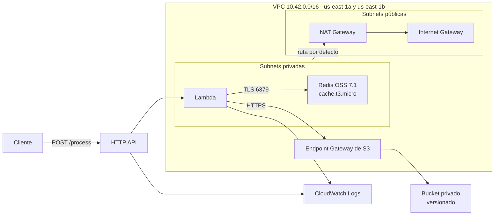
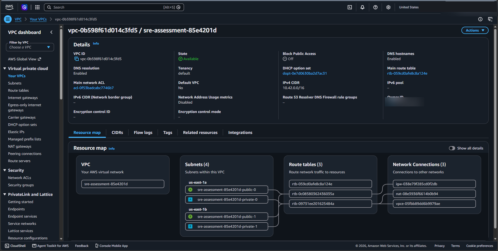
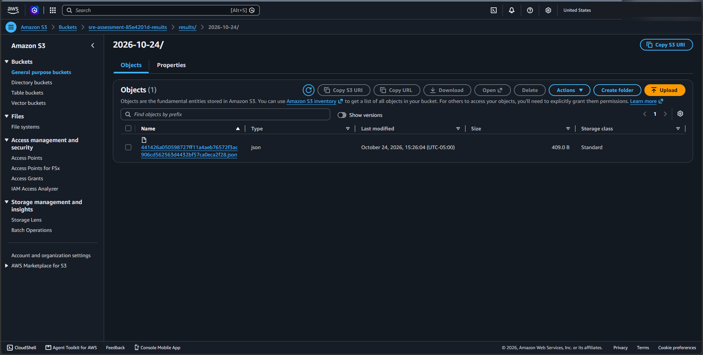
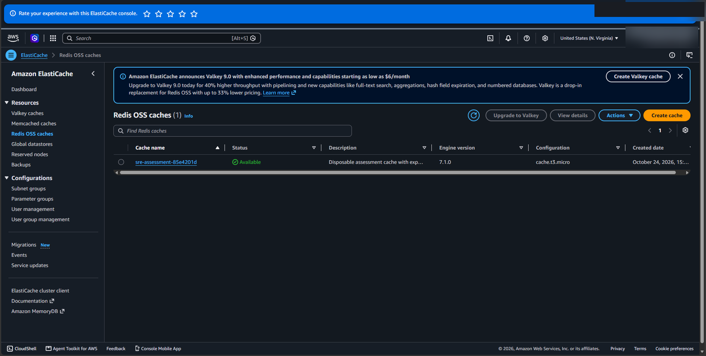
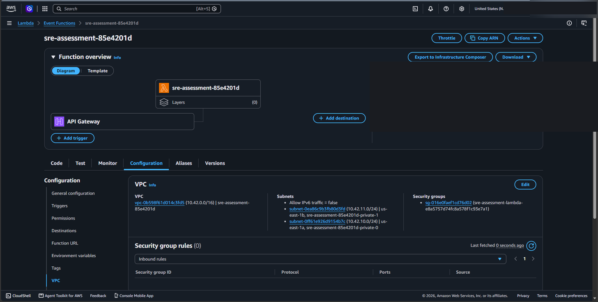

# Procesador de solicitudes en AWS

Servicio de procesamiento de datos construido con Terraform sobre API Gateway, Lambda,
ElastiCache Redis y S3, aislado en su propia VPC. Recibe un JSON por HTTP, lo persiste en S3
y lo reutiliza desde una caché en Redis durante 60 segundos.

La idea es sencilla: el endpoint es público, pero ni Lambda ni Redis lo son. Todo el tráfico
interior se queda dentro de la VPC, y la única puerta de entrada es API Gateway.

```
POST /process  ->  {"message": "hola"}  ->  200 OK,  X-Cache: MISS
POST /process  ->  {"message": "hola"}  ->  200 OK,  X-Cache: HIT
```

## Qué hay aquí

| Ruta | Contenido |
| --- | --- |
| `main.tf` | Provider, variables, recursos aleatorios y salidas del stack |
| `network.tf` | VPC, subnets, tablas de rutas, NAT, endpoint de S3 y security groups |
| `storage.tf` | Bucket de S3, su política, versionado, cifrado y el grupo de ElastiCache |
| `service.tf` | Funcion Lambda, su rol, la API HTTP y el stage con throttling |
| `src/handler.py` | El handler: normaliza, cachea, persiste y responde |
| `tests/` | Pruebas unitarias del flujo de caché y de los caminos de error |
| `scripts/` | Empaquetado del artefacto Lambda y verificación end-to-end |
| `evidence/` | Evidencia real de la ejecución en AWS, con capturas de la consola |

## Arquitectura



### El recorrido de una petición

1. API Gateway recibe el `POST /process` y lo reenvía a Lambda con integración proxy.
2. El handler normaliza el JSON recibido (claves ordenadas, sin espacios redundantes) y
   calcula su SHA-256. Dos cuerpos con las mismas claves en distinto orden producen la
   misma clave, así que la caché no se llena de duplicados equivalentes.
3. Busca esa clave en Redis.
   - **Si existe** devuelve el resultado guardado con `X-Cache: HIT`.
   - **Si no existe** escribe `results/YYYY-MM-DD/<sha256>.json` en S3 y *después* guarda
     la respuesta en Redis con `EX 60`. Responde `X-Cache: MISS`.
4. Ante cualquier excepción, registra el fallo en CloudWatch y responde HTTP 500 indicando
   en qué paso se rompió, sin filtrar credenciales ni trazas internas.

El orden importa: si la escritura en S3 falla, no se cachea nada. Nunca devolvemos un `HIT`
de un resultado que no llegó a persistirse.

### Red

- **Dos subnets públicas y dos privadas**, repartidas entre `us-east-1a` y `us-east-1b`.
  Pública y privada se define por las rutas, no por la asignación de IP pública: en este
  stack la asignación automática está desactivada en todas las subnets.
- **Un NAT Gateway** en una subnet pública, con su Elastic IP. Da salida a las subnets
  privadas, como pide el diseño de referencia.
- **Endpoint Gateway de S3** asociado a la tabla de rutas privada. El tráfico a S3 sale por
  la red de AWS, no por internet, y el endpoint no tiene coste por hora ni por datos.
- **Security groups separados**: Redis acepta el puerto 6379 únicamente desde el SG de
  Lambda, referenciando el grupo en lugar de abrir un CIDR. Lambda solo sale hacia Redis y
  hacia la lista de prefijos de S3.

### Almacenamiento

- **S3**: bloqueo de acceso público en sus cuatro opciones, versionado activo y cifrado
  SSE-S3. La política del bucket rechaza el tráfico sin TLS, las operaciones de objeto de
  cualquier principal que no sea el rol de Lambda, y las operaciones de objeto que no
  llegan a través del endpoint de la VPC.
- **Redis**: un nodo `cache.t3.micro`, engine 7.1, con cifrado en reposo, TLS en tránsito
  y token de autenticación generado por Terraform. Cada escritura lleva su propio TTL de
  60 segundos; S3 es el almacenamiento duradero, la caché solo evita repetir trabajo.

### API

HTTP API con integración proxy `AWS_PROXY` y payload format 2.0. CORS permite cualquier
origen y expone la cabecera `X-Cache` para que el navegador pueda leerla. El stage lleva
throttling de 1 solicitud/s con ráfaga de 2 y registra los accesos en CloudWatch.

## Requisitos

- Una cuenta de AWS y una identidad de despliegue que no sea root.
- Terraform >= 1.9 y < 2.0. Probado con 1.16.6; los providers están fijados en
  `.terraform.lock.hcl`.
- Python 3.12, [uv](https://docs.astral.sh/uv/) y AWS CLI v2 con soporte de `aws login`.

La identidad de despliegue necesita permisos sobre VPC/EC2, ElastiCache, Lambda,
API Gateway v2, S3, CloudWatch Logs, roles y políticas IAM, e `iam:PassRole`. El primer uso
de ElastiCache puede requerir crear su rol vinculado al servicio.

Conviene distinguir dos identidades: la que despliega y el rol que ejecuta la función. El
rol de Lambda está acotado a `s3:PutObject` sobre `results/*` y a escribir en su propio
grupo de logs. La identidad de despliegue es más amplia porque tiene que crear la
infraestructura, pero sigue sin ser root.

## Puesta en marcha

Los comandos siguientes usan Bash. En Windows funcionan en Git Bash con las herramientas
disponibles en `PATH`.

```bash
# 1. Sesión de consola con una identidad sin privilegios root.
aws login --profile sre-assessment-deployer --region us-east-1

# 2. Terraform obtiene credenciales temporales del propio CLI,
#    sin guardar claves de acceso en el proyecto.
aws configure set credential_process \
  'aws configure export-credentials --profile sre-assessment-deployer --format process' \
  --profile sre-assessment-terraform
export AWS_PROFILE=sre-assessment-terraform
export AWS_REGION=us-east-1
aws sts get-caller-identity

# 3. Dependencias de Python y empaquetado del artefacto.
uv venv --python 3.12 --seed
uv pip install -r requirements-dev.txt
uv run --no-project python scripts/package.py

# 4. Pruebas unitarias.
uv run --no-project python -m pytest -q

# 5. IaC.
cp terraform.tfvars.example terraform.tfvars
terraform init
terraform fmt -check
terraform validate
terraform plan
terraform apply
```

En Windows, si Terraform no logra ejecutar `credential_process`, reemplaza `aws` en esa
configuración por una ruta absoluta sin espacios, por ejemplo
`C:/PROGRA~1/Amazon/AWSCLIV2/aws.exe`. La configuración de perfiles vive fuera del
repositorio.

El empaquetado instala el cliente Redis en una versión fijada y escrita en Python puro, de
modo que el zip funciona en Amazon Linux sin compilar nada. Boto3 lo aporta el runtime de
Lambda. Después de esta preparación, un solo `terraform apply` levanta la aplicación
completa: no hay ningún recurso creado a mano en la consola.

> **El estado y los planes de Terraform contienen el token de Redis**, aunque Terraform lo
> marque como sensible. Están fuera de Git. En un entorno compartido habría que configurar
> un backend remoto cifrado, con bloqueo y acceso restringido, antes de desplegar.

## Verificación

Dos peticiones con el mismo cuerpo, con un identificador distinto en cada prueba para no
reutilizar una entrada anterior de la caché:

```bash
URL=$(terraform output -raw api_url)
BODY="{\"message\":\"hola\",\"verification_id\":\"$(date +%s)\"}"

curl -i "$URL" -H 'Content-Type: application/json' --data "$BODY"
sleep 2
curl -i "$URL" -H 'Content-Type: application/json' --data "$BODY"

aws s3 ls "s3://$(terraform output -raw bucket_name)/results/" --recursive
```

La primera respuesta debe ser `200` con `X-Cache: MISS` y la segunda `200` con
`X-Cache: HIT`, con el mismo JSON en el cuerpo. Pasados los 60 segundos del TTL, la
siguiente petición vuelve a ser `MISS`.

Para comprobarlo automáticamente y guardar la evidencia:

```bash
uv run --no-project python scripts/verify.py \
  --url "$(terraform output -raw api_url)" \
  --bucket "$(terraform output -raw bucket_name)" \
  --profile sre-assessment-terraform
```

El script guarda las peticiones y respuestas en `evidence/requests.json` y el objeto
encontrado en `evidence/s3-object.json`. Las pruebas unitarias de `tests/` usan dobles de
prueba: no sustituyen a esta comprobación contra AWS.

## Evidencia

Todo lo que hay en `evidence/` salió de una ejecución real en `us-east-1`. El stack se
creó, se verificó de extremo a extremo y se eliminó después.

| Archivo | Qué demuestra |
| --- | --- |
| `requests.json` | Las dos peticiones reales, con sus cabeceras y cuerpos |
| `s3-object.json` | El objeto persistido, con tamaño y fecha |
| `s3-ls.txt` | Salida de `aws s3 ls --recursive` sobre el prefijo de resultados |
| `security-and-network-checks.json` | Bloqueo público, versionado, cifrado, red, throttling y cifrado de Redis |
| `deployment-lifecycle.json` | Recursos creados y eliminados por Terraform, y resultado end-to-end |
| `cleanup-checks.json` | Comprobación de que no queda ningún recurso en AWS |
| `unit-tests.txt` | Salida de pytest |

Las capturas de la consola de AWS:

| Captura | Qué muestra |
| --- | --- |
|  | Las cuatro subnets en dos zonas, las tres tablas de rutas, el Internet Gateway, el NAT y el endpoint de S3 |
|  | El bucket con el objeto `results/2026-10-24/441426a0….json` de 409 bytes |
|  | La caché Redis OSS en estado Available, engine 7.1.0, nodo `cache.t3.micro` |
|  | La función con su disparador de API Gateway y su configuración de VPC con dos subnets privadas |

Antes de publicarlas se ocultaron los datos de identidad: la barra de pestañas del
navegador, el menú de usuario de la consola, el ID de la cuenta de AWS, el campo *Owner
ID* de la VPC y el ARN de la función. Los identificadores de recursos se dejaron
visibles a propósito, porque son la evidencia de la topología y no son credenciales. No
se capturaron las variables de entorno de Lambda ni el token de autenticación de Redis.

## Decisiones de diseño

**HTTP API en lugar de REST API.** El caso de uso es un endpoint público que recibe un
JSON, reenvía a Lambda y devuelve un JSON. HTTP API cubre eso con integración proxy, CORS,
throttling y logs de acceso, sin las funciones de REST API ni su coste.

**Un solo nodo de Redis y un solo NAT.** Es una decisión de coste para un entorno de
laboratorio, no una arquitectura de alta disponibilidad. Tener dos subnets privadas no
convierte a Redis en Multi-AZ; un despliegue de producción evaluaría réplica con failover
y salida por zona.

**S3 como almacén duradero y Redis como caché.** El TTL de 60 segundos está en cada
escritura de la aplicación, no como configuración global del servidor Redis. Si Redis se
vacía, el sistema sigue siendo correcto: solo se pierde el ahorro de cómputo.

**Escritura antes que caché.** El orden S3 -> Redis garantiza que nunca se anuncie como
cacheado un resultado que no se persistió. El punto débil es que dos peticiones
concurrentes con la misma clave pueden procesarse las dos: el patrón cache-aside no
ofrece exclusión mutua por sí solo. Las claves deterministas y el versionado del bucket
conservan las escrituras repetidas.

**Errores de validación como 500.** Cualquier excepción devuelve 500 con un mensaje
descriptivo, que es el contrato que sigue el handler. En una API real distinguiría los
errores del cliente con respuestas 4xx.

**Una identidad de despliegue separada del rol de ejecución.** Desplegar y ejecutar son
problemas distintos, con permisos distintos. El rol de la función no puede crear
infraestructura ni salir de la VPC.

**Permisos ENI con una denegación explícita.** Conectar Lambda a la VPC exige permisos
sobre interfaces de red, y algunos de ellos requieren `Resource: *`. El rol los incluye
para que la plataforma pueda crear la interfaz, pero lleva una denegación condicionada a
`lambda:SourceFunctionArn` para que el propio código de la función no pueda usarlos.

## Coste y disponibilidad

La referencia de coste fijo del stack es de unos **0,067 USD por hora**: NAT Gateway
(0,045), nodo `cache.t3.micro` (0,017) y la IPv4 pública del NAT (0,005). El endpoint
Gateway de S3 no tiene coste por hora ni por datos, y Lambda, HTTP API, S3 y CloudWatch se
cobran por uso. No se asumen créditos gratuitos ni Planes Gratuitos.

En la práctica, una sesión de despliegue y verificación de menos de una hora queda por
debajo de un dólar, contando las peticiones, el almacenamiento y los logs. El throttle de
1 solicitud por segundo limita el daño si alguien deja el endpoint desplegado.

## Límites conocidos

- El endpoint es público y **no está autenticado**: es un servicio de demostración. CORS
  controla qué navegadores pueden leer la respuesta, no quién puede llamar al servicio.
- El throttle del stage es una protección de mejor esfuerzo, no un tope de gasto. AWS no
  ofrece un corte instantáneo de facturación por umbral.
- La caché no evita el trabajo duplicado en peticiones concurrentes.
- El handler acepta cuerpos de hasta 16 KiB, con timeout de 10 segundos y tiempos de
  espera más cortos hacia Redis y S3. Un timeout externo al handler no lo captura Python.
- Redis y NAT son puntos únicos de fallo, por el diseño que se ha descrito.

## Limpieza

```bash
terraform destroy
terraform state list
```

**La eliminación borra el bucket y todas las versiones de sus objetos**, porque el bucket
está declarado con `force_destroy = true`. Es una decisión consciente para un entorno
desechable, no una configuración para producción. Las dependencias de Terraform hacen que
la política restrictiva del bucket se retire antes de borrar los objetos, de modo que el
proceso no se bloquea a sí mismo.

El estado de Terraform vacío no es una comprobación suficiente: en
`evidence/cleanup-checks.json` queda la verificación hecha contra las API de AWS, recurso
por recurso, tras la eliminación. Conserva el estado y las credenciales hasta terminar la
limpieza; borrar archivos locales no elimina nada en AWS.

## Formato del código

```bash
uv run --no-project python -m pytest -q   # pruebas
uvx ruff check src tests scripts          # lint
uvx ruff format --check src tests scripts # formato
terraform fmt -check
terraform validate
```

## Licencia

MIT.
